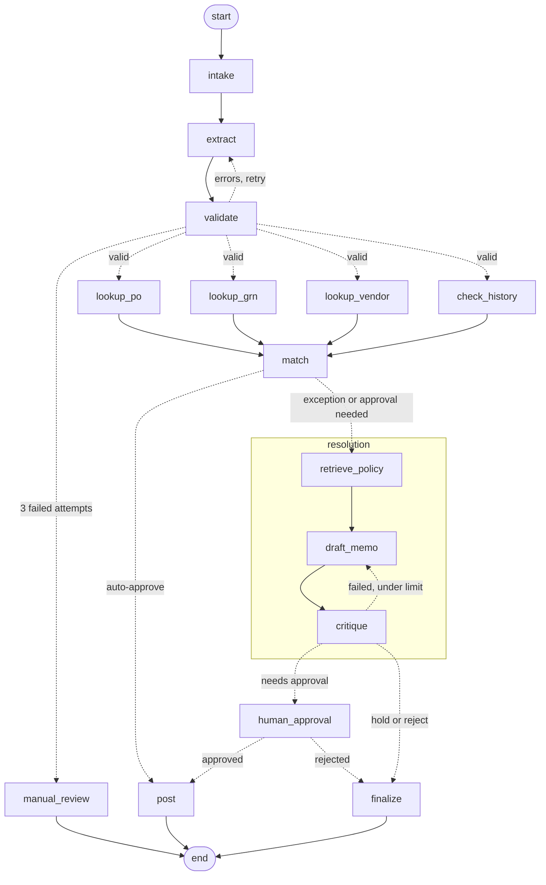

# Model answer (Module 1)

## 1. Nodes
| # | Node | Type | What it does |
|---|---|---|---|
| 1 | intake | validation | Scans the document for injected instructions, masks the bank account |
| 2 | extract | **model** | Turns invoice text into structured fields |
| 3 | validate | validation | Arithmetic and completeness checks on the fields |
| 4 | manual_review | action | Fallback when extraction keeps failing |
| 5 | lookup_po | tool | Purchase order lines |
| 6 | lookup_grn | tool | Goods receipt lines |
| 7 | lookup_vendor | tool | Vendor master record |
| 8 | check_history | tool | Posted invoices with the same number |
| 9 | match | action (rules) | Three-way match, then disposition and approver from the policies |
| 10 | retrieve_policy | tool (retrieval) | Finds the policy sections for this exception |
| 11 | draft_memo | **model** | Writes the note for the approver, with citations |
| 12 | critique | **model** | Reviews the note; sends it back if a citation is missing |
| 13 | human_approval | human | Pauses until the named approver decides |
| 14 | post | action | Posts to the ledger |
| 15 | finalize | action | Records hold, rejection or pending status |

Only three of fifteen nodes call a model. The decision itself (step 5 of the brief) is code, because the Controller requires it to be re-performable.

## 2. Shared state
| Field | Written by | Read by | Reducer? |
|---|---|---|---|
| raw_text | input | intake | no |
| clean_text, security_flags | intake | extract, match | no |
| invoice | extract | validate, lookups, match, memo nodes, post | no |
| validation_errors, extraction_attempts | validate, extract | router, extract | no |
| po_lines / grn_lines / vendor / history_hits | one lookup each | match | no (separate fields) |
| tools_called, tool_errors | all four lookups | match, evals | **yes** (parallel writers append) |
| exceptions, disposition, approver | match | routers, memo nodes | no |
| policy_chunks, memo, critique, revisions | resolution subgraph | human_approval | no |
| approval | human_approval | post | no |
| status | post, finalize, manual_review | caller | no |

## 3. Routers
| After | Rule |
|---|---|
| validate | errors and attempts < 3: back to extract. errors and attempts = 3: manual_review. Otherwise fan out to the lookups (PO and GRN only if a PO is quoted) |
| match | AUTO_APPROVE: post. Anything else: resolution |
| critique | passed or 2 revisions done: leave the subgraph. Otherwise revise |
| resolution | ROUTE_FOR_APPROVAL: human_approval. HOLD or REJECT: finalize |
| human_approval | approved: post. Rejected: finalize |

## 4. Parallel paths
The four lookups are independent. They fan out from `validate` and fan in at `match`.

## 5. Subgraph
`retrieve_policy -> draft_memo <-> critique` is the **resolution** subgraph. It has a narrow state of its own and can be evaluated alone.

## 6. End states
POSTED, PENDING_APPROVAL, REJECTED_BY_APPROVER, ON_HOLD, REJECTED, MANUAL_REVIEW.

## 7. Graph

